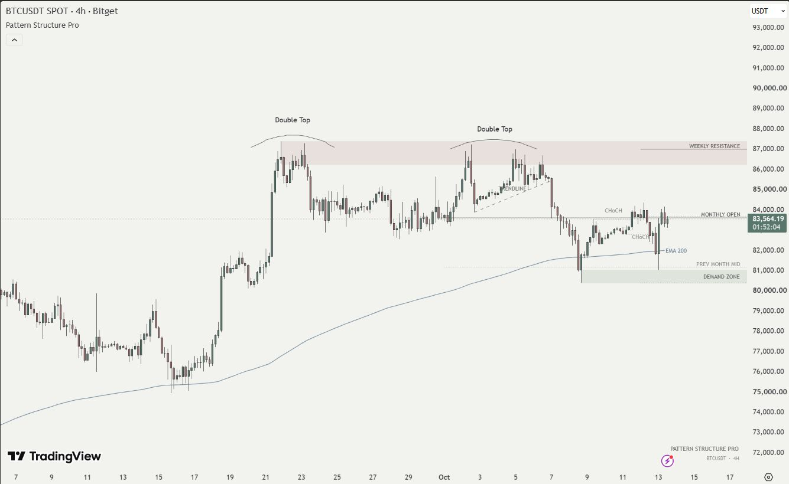
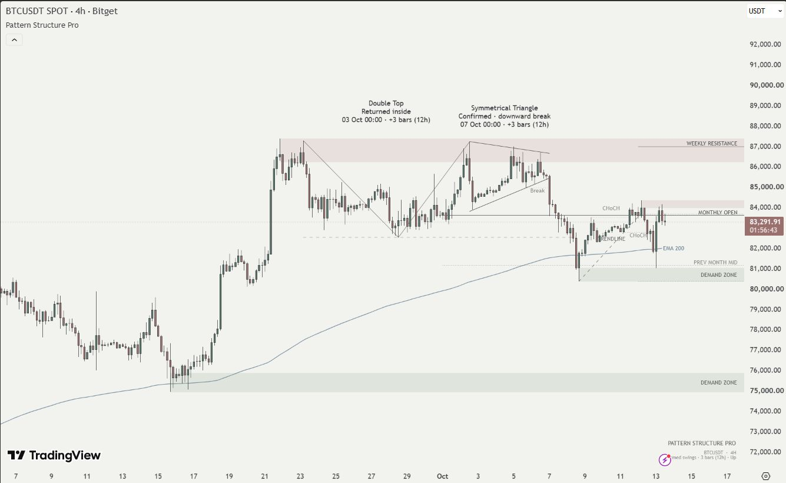

# Pattern Structure Pro (PSP)

Pattern Structure Pro is a TradingView Pine Script v6 indicator that brings chart patterns, swing structure, and price context into one considered layout. It supports standard **1H, 2H, 4H, and 1D** candlestick charts, with a clean **Stories** view for sharing analysis and a more detailed **Analysis** view for examining it.

## Overview

Stories view on **BITGET:BTCUSDT, 4H**: two local Double Tops, a historical trendline, weekly resistance, monthly references, a demand zone, and EMA 200. This is a fresh capture of the running indicator, not a manually annotated chart.

## Features

- **18 pattern variants:** Double and Triple Top/Bottom; Head & Shoulders and Inverse H&S; ascending, descending, and symmetrical triangles; rising and falling wedges; bullish and bearish flags and pennants; ascending and descending channels; and rectangles.
- **Market structure:** optional HH, HL, LH, LL, EQH, and EQL labels. Closed-bar breaks are classified as BOS, CHoCH, or a neutral Break from the established swing structure.
- **Price context:** swing-based supply/demand zones, previous week high/low/midpoint, previous month midpoint, and current month open. Editorial presentation labels the previous week high as Weekly Resistance.
- **Trend references:** a confirmed swing trendline that stops at its first closed-bar break, plus an optional 200-period EMA on the same price scale.
- **Controlled presentation:** up to three distinct selected patterns, transparent zones, thin levels, priority-based labels, automatic light/dark colors, and bounded drawing storage. Lower-priority text is suppressed when it conflicts with important annotations.

There are no BUY/SELL calls, projected price paths, entries, stops, targets, or order execution.

## How It Works

### Reference points and detection

The engine uses confirmed pivot highs and lows with equal left- and right-hand strength. With the default strength of **3**, a swing requires three later candles to close. Ambiguous candles that qualify as both a high and a low are skipped. Consecutive same-side swings retain the more extreme point, producing an alternating swing sequence. ATR(14) supplies the price scale for tolerances on the current chart interval.

| Chart interval | Default swing confirmation | ATR and EMA inputs |
| --- | --- | --- |
| 1H | 3 closed bars / 3 hours | 1H candles |
| 2H | 3 closed bars / 6 hours | 2H candles |
| 4H | 3 closed bars / 12 hours | 4H candles |
| 1D | 3 closed bars / 3 trading days | Daily candles |

Switching the chart interval automatically recalculates the entire engine on that interval. Geometry windows, expiry, and confirmation are measured in **bars**, while price tolerances use that interval's ATR; they are not forced into a fixed 4H wall-clock duration. The 4H detection thresholds are preserved. Analysis captions show both the bar delay and its interval duration. For markets with session gaps, three daily bars can take longer than three calendar days.

Reversal candidates compare three or five anchors for matching extremes, adequate intervening depth, prior price context, and—for head and shoulders—head prominence and shoulder timing. Double Top/Bottom detection also searches across minor intervening swings while rejecting an overtopping extreme or a separate central third contact.

Other formations fit upper and lower lines to swing highs and lows. Contact spacing, fit error, slope, width contraction, and the position of the intersection distinguish triangles, wedges, channels, and rectangles. The engine checks historical closes against the boundaries and limits excessive wick violations. Flags and pennants additionally require an efficient preceding impulse of at least 3 ATR, a short consolidation, and no more than 50% retracement of that impulse.

Candidates receive a geometric quality score. The minimum-quality setting filters the display; the score is **not** a probability of a profitable trade. Overlapping candidates compete for the available slots. Selection favors recent breaks and defined family precedence; Stories/Editorial also gives compact reversals presentation priority.

### Confirmation, invalidation, and expiry

| State | Meaning |
| --- | --- |
| Forming | The required geometry exists, but a qualifying close beyond the boundary has not occurred. |
| Active structure | The display name for a channel or rectangle that remains within its boundaries. |
| Confirmed · upward/downward break | A closed candle passed the applicable boundary plus the ATR break buffer. Reversals and flags/pennants require their defined direction; direction-neutral formations can confirm either way. |
| Broken · upward/downward | A channel or rectangle closed beyond its boundary and buffer. |
| Returned inside | Price later closed back between the boundaries. The earlier break remains recorded. |

Unconfirmed reversals invalidate when price closes beyond the opposite extreme and buffer. Flags/pennants invalidate on a qualifying break against their impulse direction. Candidates also expire: channels/rectangles after 60 bars from their final anchor, other formations after 30 bars from detection, and reversals after a span-dependent 30–120 bars. Converging patterns expire on reaching their intersection. Invalid and expired candidates are excluded from the display; old candidates and finished patterns also have age limits.

Supply/demand zones require at least 1.5 ATR departure from a confirmed swing. Their width derives from the pivot candle's wick/body relationship and is bounded to 0.2–1 ATR. A close beyond the far edge and buffer invalidates a zone; a touch alone does not. Overlapping same-side zones merge for display without changing their stored source geometry. Stories filters distant zones and presents one primary zone on each side where eligible zones exist; Analysis can show more.

### Developing formations and historical drawings

Detection and state transitions run on closed bars. Pattern geometry is stored when registered, and the EMA plot omits the open candle. Weekly/monthly context uses completed previous-period values and the current month's known opening price.

**Closed-bar processing does not mean an annotation was available at its historical anchor.** A newly detected pattern is drawn back over the candles that formed it, after swing confirmation. Analysis captions show the final anchor's detection time and confirmation delay. The most recent same-side swing can be replaced before a later opposite swing arrives, and the selected drawings can change as new data arrives.

PSP redraws the current selection rather than retaining every historical drawing. Scrolling back alone does not reconstruct what was visible at that earlier moment. Data-feed corrections, changed settings, and different timeframes can change a recalculated chart. These distinctions matter when assessing repainting or reviewing examples after the event.

## Screenshots

The images were captured on **13 October 2026**, directly in TradingView through the **Codex browser**, using the production source on BITGET:BTCUSDT. Browser screenshot clipping removes surrounding panels and toolbars; candles, price axes, labels, and drawings are unchanged. No patterns were manually added.

### Stories

Compact pattern names and proportionate historical arches keep the structure readable. EMA 200 and the main zone/period references provide context around the candles.

### Analysis

The same market window in Analysis view shows anchor geometry, a Double Top marked Returned inside, and a symmetrical triangle marked Confirmed · downward break. Captions include detection time and a three-bar swing delay. The two modes can select different candidates from the same detection engine because their presentation priorities differ.

### Other supported intervals

[1H Analysis](assets/screenshots/psp-1h-analysis.jpg) · [2H Analysis](assets/screenshots/psp-2h-analysis.jpg) · [1D Analysis](assets/screenshots/psp-1d-analysis.jpg)

These capture the same engine recalculated on each chart interval. A current window can legitimately have no selected pattern; the structure, zones, levels, and EMA still provide context. Confirmation timing is 3h, 6h, 12h, or 3d at the default swing strength. Live checks confirm runtime and rendering on the observed windows, not broad pattern-recognition accuracy across every historical period.

## Installation

1. Open a standard candlestick chart in TradingView and select **1H, 2H, 4H, or 1D**.
2. Open [`src/PatternStructurePro.pine`](src/PatternStructurePro.pine) and copy the entire file.
3. Open TradingView's **Pine Editor**, create a new indicator, and replace its template with the copied source.
4. Save the script privately and select **Add to chart**.
5. Open the indicator settings to choose Stories or Analysis and enable the layers you need. Publishing the script is not required.

For clean exports, close the editor and side panels, move the pointer outside the chart, and leave enough right margin for the extended zones and levels. Chart background and candle colors are TradingView settings; PSP does not change them or provide an automatic Instagram 9:16 export.

## Settings

### Detection

| Input | Default | Controls |
| --- | --- | --- |
| Confirmed swing strength | 3 (2–10) | Left/right pivot strength and resulting confirmation delay. |
| Matching levels · ATR | 0.40 (0.10–1.00) | Matching-extreme tolerance for Double/Triple Top/Bottom candidates. |
| Boundary contact · ATR | 0.35 (0.10–0.80) | Boundary fit/contact tolerance and related containment checks. |
| Closed-bar break · ATR | 0.15 (0.05–0.50) | Buffer used in pattern breaks, structure breaks, and invalidation checks. |
| Minimum geometric quality | 65 (0–100) | Minimum candidate quality eligible for presentation. |

### Pattern families

All six family switches default to **on**: **Double / Triple Top & Bottom**, **Head & Shoulders / Inverse**, **Triangles**, **Wedges**, **Flags / Pennants**, and **Channels / Rectangles**. Each switch controls that family's candidate detection.

### Market structure and trend context

| Input | Default | Controls |
| --- | --- | --- |
| HH / HL / LH / LL | Off | Recent swing labels, including EQH/EQL for nearly equal swings. |
| BOS / CHoCH | On | Recent structure-break lines and captions; neutral Break captions are hidden in Stories. |
| Swing supply / demand zones | On | Valid swing-zone rendering. |
| Week / month levels | On | The five weekly/monthly reference levels. |
| Confirmed swing trendline | On | A validated rising-support or falling-resistance swing line. |
| EMA 200 | On | The 200-period close EMA and its label on the chart's timeframe. |

### Presentation

| Input | Default | Controls |
| --- | --- | --- |
| View | Stories | Stories prioritizes clarity; Analysis adds states, timing, and more context. |
| Patterns in Stories | 3 (1–3) | Maximum Stories pattern count. Analysis is capped at three. |
| Annotation style | Editorial | Editorial uses reversal arches and compact captions in Stories; Technical uses anchor geometry and full states. Analysis uses anchor geometry in either style. |
| Chart theme | Auto | Auto selects ink from the chart background; Light/Dark force the palette. |
| Text size | Normal | Small, Normal, or Large; secondary labels remain smaller. |
| Zone transparency | 82 (65–95) | Zone fill transparency; touched zones become slightly more transparent. |
| Zone / level extension · bars | 30 (0–40) | Right extension of existing horizontal context, not a projected price path. |
| Compact title | On | The small PSP title and instrument note. Context notes can still appear when the title is disabled. |

## Limitations

Recognition is algorithmic and can miss formations or accept false positives. The library is a defined set of 18 variants, not every possible chart pattern. Zones represent swing-based price areas, not verified institutional orders. Standard candles are the intended input; synthetic candles change the geometry.

Label spacing estimates text bounds in bars and ATR rather than measuring screen pixels, so very tight zoom or large text can still require chart adjustments. Only selected recent structures are shown. No broad real-market accuracy percentage or profitable-trading claim is made, and a full historical 4H Replay validation matrix has not been completed.

## Disclaimer

PSP supports technical analysis and does not provide financial advice. Trading involves risk and can result in loss. A detected pattern or confirmed break does not guarantee a future price move.

## License

Required Notice: Copyright © 2026 builtbyuba.

The existing noncommercial licensing choice is retained: [PolyForm Noncommercial License 1.0.0](LICENSE). It does not grant permission to sell PSP or use it for purposes outside the license's permitted terms. Separate permission is required for commercial licensing. Including source in this private repository does not make the project open-source.
